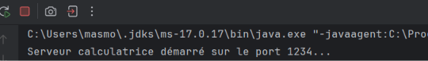
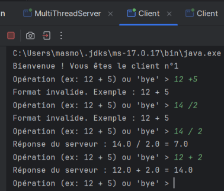
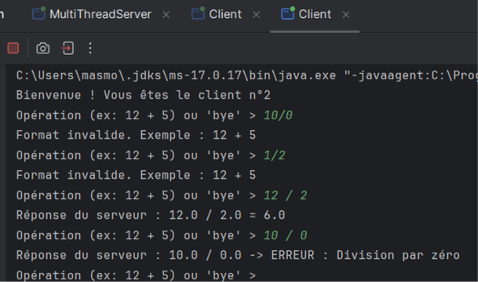
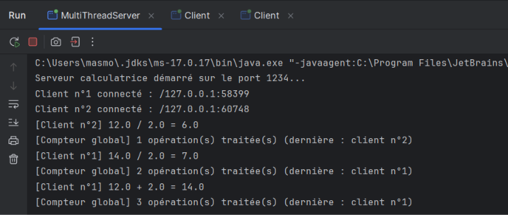
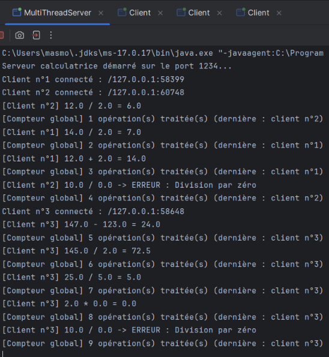

# TP3 : Serveur Multi-threads – Sockets TCP

## Activité 3-2 : Amélioration de l'application calculatrice

---

## 1. Objectif

- plusieurs clients connectés simultanément, chacun servi par son propre thread ;
- communication **par objets** (`ObjectInputStream` / `ObjectOutputStream`) ;
- un **compteur global** d'opérations, partagé et **synchronisé** (gestion de l'accès concurrent).

## 2. Structure du projet

## 3. Principe de fonctionnement

### 3.1 Communication par objets
- `Operation` implémente `Serializable` : elle peut traverser le réseau.
- Le client crée une `Operation(operande1, operateur, operande2)` et l'envoie avec `writeObject()`.
- Le serveur la reçoit avec `readObject()`, la complète (`resultat` ou `erreur`) et la renvoie.
- Le client envoie la chaîne `"bye"` pour terminer la session.
- Points d'attention :
    - on crée d'abord l'`ObjectOutputStream` et on fait `flush()`, puis l'`ObjectInputStream`, pour éviter un blocage mutuel client/serveur sur l'en-tête du flux ;
    - `reset()` avant chaque `writeObject()` évite le renvoi d'une version en cache d'un objet déjà envoyé.

### 3.2 Serveur multi-thread
- `MultiThreadServer` boucle sur `accept()`, numérote chaque client, affiche son adresse IP
  (`getRemoteSocketAddress()`), puis lance un thread `ClientProcess`.
- Chaque `ClientProcess` gère sa propre communication indépendamment des autres.
- Opérations gérées : `+`, `-`, `*`, `/` ; la division par zéro et les opérateurs inconnus
  renvoient une erreur dans l'objet.

### 3.3 Accès concurrent : compteur global
- `CompteurGlobal.total` est une ressource critique partagée par tous les threads.
- - `total++` n'est pas atomique : c'est en réalité trois étapes (lire la valeur, ajouter 1,
    écrire le résultat). Si deux threads lisent la même valeur en même temps (par exemple 5),
    ils écrivent tous les deux 6 au lieu de 7 : **une incrémentation est perdue**.

- La méthode `static synchronized incrementer()` garantit qu'un seul thread à la fois modifie
  le compteur. L'affichage est fait **dans** la section critique, donc les valeurs sont
  affichées dans l'ordre (1, 2, 3, …).

## 4. Tests en local

### 4.1 Démarrage du serveur

*Capture 1 : le serveur calculatrice attend les clients sur le port 1234.*

### 4.2 Plusieurs clients en parallèle

*Capture 2 et 3 : plusieurs clients envoient des opérations ; chacun reçoit son numéro d'ordre et ses résultats.*

### 4.3 Console du serveur et compteur global

*Capture 4 : le serveur affiche chaque opération et la nouvelle valeur du compteur global.*

## 5. Autre Test

Avec 3 clients connectés simultanément qui envoient chacun plusieurs opérations,
le compteur global s'incrémente dans l'ordre (1, 2, 3, …) sans doublon ni valeur manquante,
quel que soit le client qui envoie l'opération. La méthode `synchronized` garantit donc
la cohérence du compteur.

## 6. Synthèse

- **Multi-thread :** le thread principal ne fait que `accept()`. Chaque client a son thread
  `ClientProcess` : les clients ne se bloquent plus entre eux.
- **Objets :** échanger un objet `Operation` est plus structuré que du texte : pas de parsing côté
  serveur, le résultat et l'erreur voyagent dans le même objet.
- **Concurrence :** le compteur global est une ressource critique. `synchronized` garantit
  l'exclusion mutuelle : le test avec 3 clients simultanés donne un compteur exact et cohérent.
- **Limites et améliorations :** un thread par client ne passe pas à grande échelle (pool de
  threads `ExecutorService`) ; pour un simple compteur, `AtomicInteger` serait une alternative
  sans verrou.

## 7. Conclusion

Ce TP a permis d'étendre le service de calculatrice en serveur multi-thread à communication par
objets, avec une gestion correcte de l'accès concurrent à une ressource partagée.

